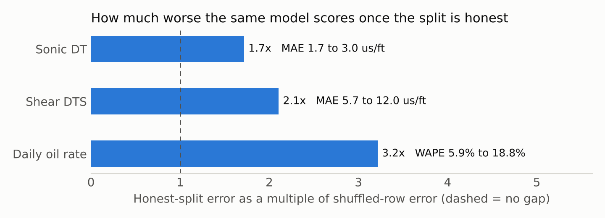
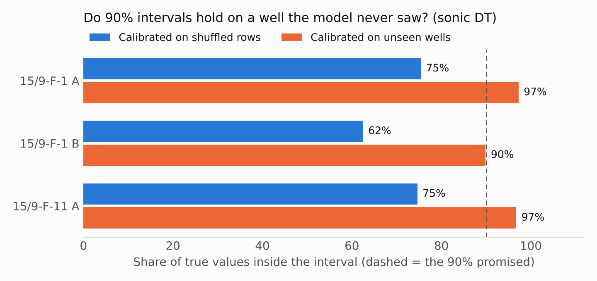
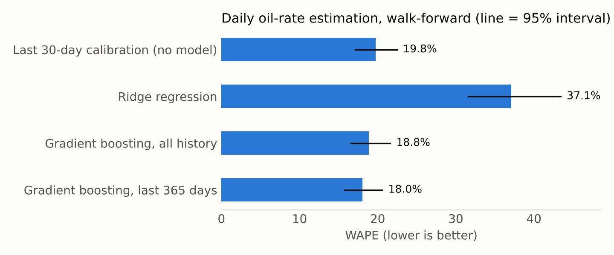
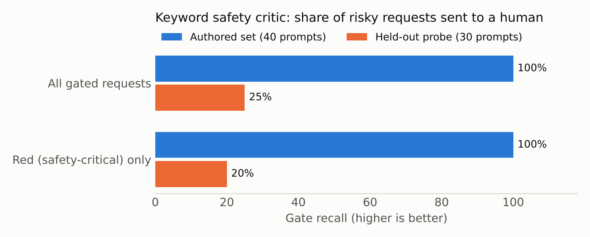

# Kasauti

**A touchstone for operational AI, struck on real Volve field data.**

*Kasauti* (कसौटी) is the black stone a goldsmith rubs metal against to see whether it is gold.
This repository does the same job for AI in asset-heavy industry: it takes three ideas that
demonstrate well, runs them on a real oil field's records under honest test conditions, and
publishes what survives.

It began as three separate prototypes: a petrophysics model (PetroVision), an operations
copilot with a human approval gate (AgenticAI-Copilot) and a tool-governed asset assistant
(Asset-Intelligence). All three ran on synthetic data. Kasauti merges them into one package,
replaces the synthetic data with the Volve field dataset, and scores every claim blind.

## What the first run found

All numbers below are reproduced by `kasauti reproduce`. Full tables: [results/RESULTS.md](results/RESULTS.md).

**1. A shuffled test split flatters the same model by 1.7 to 3.2 times.**
Gradient boosting estimating daily oil rate scores 5.9% error when days are shuffled, and
18.8% when it is trained on the past and scored on the future. For sonic logs the gap is 1.7
times (compressional) and 2.1 times (shear) between shuffled rows and a well the model has
never seen.



**2. "90% confidence" delivered 73% on a new well, until the calibration was done by well.**
Intervals calibrated the usual way, on shuffled rows, held the true sonic value 73.4% of the
time on blind wells (62.5% on the worst). Calibrated on wells the model had not seen, the same
model delivered 96.0% (89.9% on the worst).



**3. On daily oil rate, machine learning did not clearly beat a 30-day calibration factor.**
Walking forward over 6,991 well-days, the best model reached 18.0% error (95% interval 15.8 to
20.6); a baseline with no model at all, the last 30 days' rate per on-stream hour, reached 19.8%
(17.1 to 22.4). The intervals overlap. The models also over-predict by 12 to 13% in total,
against 3.6% for the baseline.



**4. For 30-day forecasts, nothing beat "the next month looks like the last one".**
Arps exponential decline was 15.9% worse than 30-day persistence at 30 days and level with it
at 90 days.

**5. A keyword safety gate that scored 100% on its own test set caught 2 in 10 safety-critical
requests when the wording was new.**
The gate sends risky requests to a human. On the 40 prompts written alongside it, it gated
every risky one. On 30 prompts written after it was frozen, it gated 25% of risky requests and
20% of the safety-critical ones.



None of this says AI does not work on operational data. It says which claims hold when the
test is fair, and it gives anyone with a better model a fixed bar to clear.

## The three tracks

| Track | Grew out of | Task | Test protocol | Truth |
|---|---|---|---|---|
| **S** Subsurface | PetroVision | Predict sonic logs (DT, DTS) from other logs | Leave one well out, 3 wells | Measured log |
| **P** Production | Asset-Intelligence | P1 daily oil rate from sensors; P2 oil over next 30 and 90 days | Walk forward in time, 5 wells, 2008 to 2016 | Reported daily volume |
| **A** Agent | AgenticAI-Copilot and Asset-Intelligence | Answer questions with read-only tools, refuse what is not in the data, send risky requests to a human | 158 tasks; truth computed from the data | Computed, or labelled |

## Run it

```bash
pip install -e ".[dev]"
kasauti fetch        # five Volve files, about 35 MB, each checked by SHA-256
kasauti run          # all tracks, about two minutes; writes results/
kasauti reproduce    # re-runs and compares every number with results/results.json
pytest               # 64 tests
```

To browse the results and try the reference agent in a browser:

```bash
pip install -e ".[app]"
streamlit run app.py
```

`requirements-lock.txt` lists the library versions behind the published numbers. With other
versions the code runs, and `kasauti reproduce` tells you which numbers moved.

## Score your own model or agent

Track A accepts any object with one method, including one that wraps a language model:

```python
def answer(self, question: str, tools: Toolbox) -> AgentResponse: ...
```

```bash
kasauti run --agent examples.llm_agent_template:MyAgent
```

The published Track A rows come from agents with no language model in them. They prove the
tasks are solvable and the scorer discriminates; they are not a claim about agent skill.
See [METHOD.md](METHOD.md), section 6.

## Why you can check this rather than trust it

- **Real data, pinned by checksum.** Results from different bytes are refused.
- **No test data in training, enforced in code.** Splits assert it on every fold; tests alter
  the future and confirm no forecast changes.
- **A null test.** With a noise target, the blind back-test reports no skill.
- **No tuning on test results.** Model settings were fixed before the first run and not changed.
- **Baselines that can win, and did.**
- **Failures are published.** Findings 3, 4 and 5 are negative results.
- **Limits are written down.** [METHOD.md](METHOD.md), section 8.

## Licences

| What | Licence |
|---|---|
| Code | Apache-2.0 ([LICENSE](LICENSE)) |
| Method, results, figures | CC BY 4.0 ([NOTICE](NOTICE)) |
| Volve data | Equinor Open Data Licence. Not included here. Read [DATA_LICENCE.md](DATA_LICENCE.md) before publishing or commercial use |

Contains data from the Volve field dataset, disclosed by Equinor ASA and the former Volve
licence partners under the Equinor Open Data Licence. Kasauti is independent work and is not
endorsed by Equinor or its partners.

## Cite

Krishnamachari, P. (2026). *Kasauti: a touchstone benchmark for operational AI on real Volve
field data* (v0.1.0). See [CITATION.cff](CITATION.cff).
